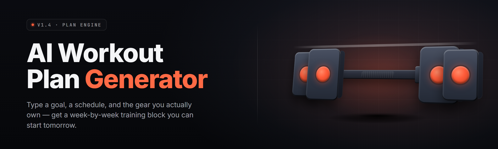

  
  
  

  

  
  
  

---

AI workout plan generator for lifters tired of paywalled coaches — builds routines from your gear, schedule, and goals in seconds.

## Overview

AI workout plan generator for lifters tired of paywalled coaches — builds routines from your gear, schedule, and goals in seconds.

  

## License

[MIT License](LICENSE)

  

